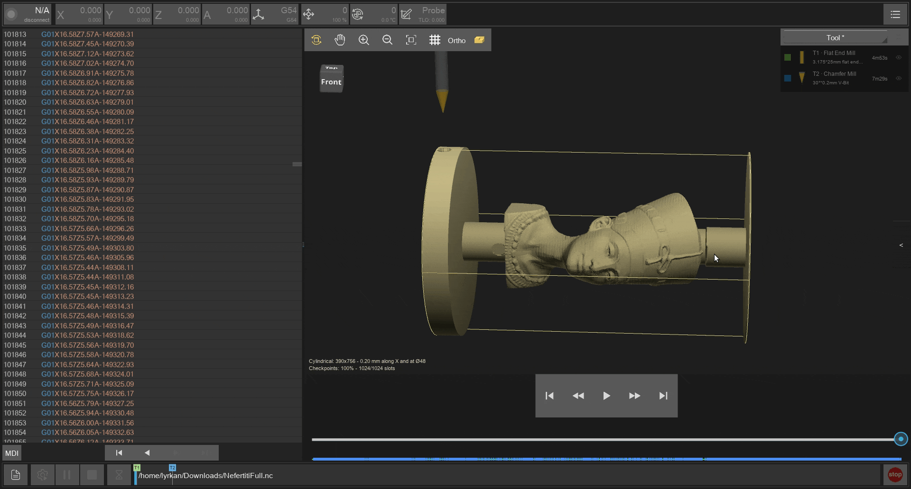
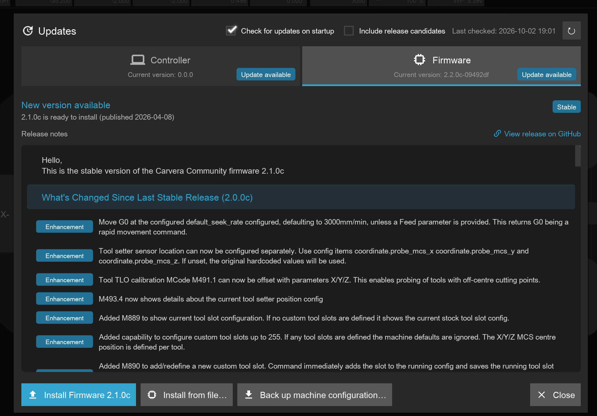
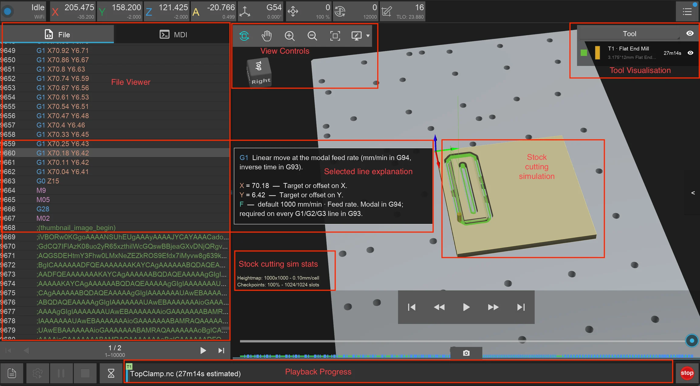
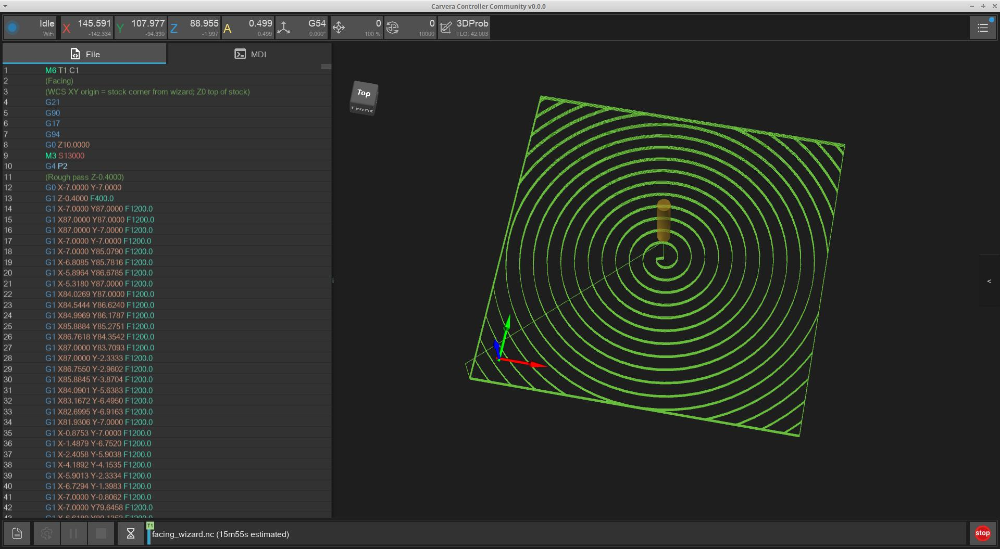
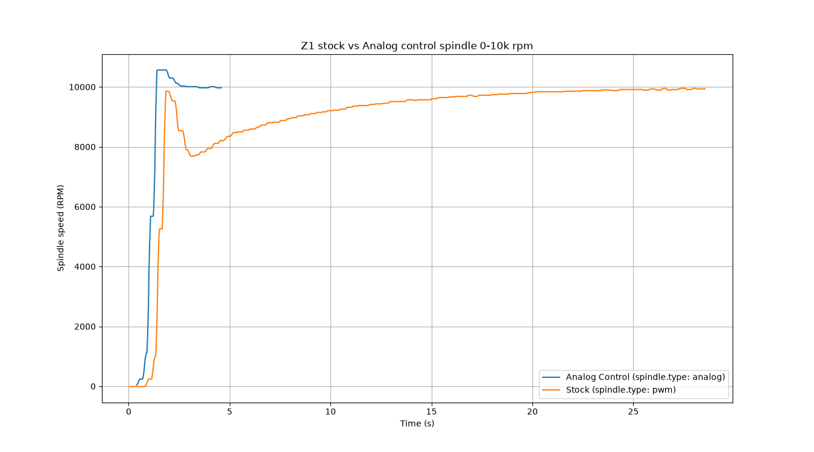

# Firmware/Controller 2.3.0-RC1

The Community software projects work to provide stable releases for our users. We achieve this by taking great care in testing new functionality first within our developer community, then to early adopters via Release Candidate (RC) pre-releases, and finally, once we are happy with the stability, we will make a full stable release. \
\
Today we release the 2.2.0 stable versions of Firmware and Controller. This has received 4 rounds of patching and testing across 3 release candidates. Turns out those communications protocol changes were a bit more tricky than we realised. Thank you to the contributors who helped iron out the bugs. See our [previous update announcement](firmware-controller-2.2.0c-rc1.md) for feature details.

You can download the release and see the full changelog on GitHub:

* [Carvera Community Firmware 2.2.0c](https://github.com/Carvera-Community/Carvera_Community_Firmware/releases/tag/2.2.0c)
* [Carvera Community Controller 2.2.0](https://github.com/Carvera-Community/Carvera_Controller/releases/tag/v2.2.0)

We also release today the first RC for 2.3.0! This release focuses on three themes: Bringing full Makera Z1 support, making the G-code viewer more informative, and modernising some of the UI experience.

We ask operators using this releases to provide feedback, positive and negative, about how they are finding the new functionality in either the #mods channel of the [Makera Discord](https://discord.gg/c6UMjEhaQA) or #feedback in the Carvera Community Discord.

You can download the releases and see the full changelog on GitHub:

* [Carvera Community Firmware 2.3.0c-RC1](https://github.com/Carvera-Community/Carvera_Community_Firmware/releases/tag/2.3.0c-RC1)
* [Carvera Community Controller 2.3.0-RC1](https://github.com/Carvera-Community/Carvera_Controller/releases/tag/v2.3.0-RC1)

See the following pages for known issues:

* [Firmware 2.3.0c-RC1](https://github.com/Carvera-Community/Carvera_Community_Firmware/issues?q=milestone%3A2.3.0c-RC2)
* [Controller 2.3.0-RC1](https://github.com/Carvera-Community/Carvera_Controller/issues?q=milestone%3Av2.3.0-RC2)

## 2.3.0 Release highlights


Please note the documentation site has separate tabs (base URLs) for Stable version and In-development version. RC features discussed in this update link to the In-Development version of the doc site, but this update article itself will be available on both sites.


### Makera Z1 & Z1 Pro Support

Full Z1 support arrives in this release for both firmware and Controller:

* **Firmware**: This is the first release that has the [Community Firmware support for the Z1 platform](https://carvera-community.gitbook.io/docs/dev/compatibility#z1-firmware-compatibility). We have been able to add Z1 machine support to the existing codebase. This means that previously developed Community firmware functionality is available on the Z1, and features developed in future will benefit owners of all three machine models.
* **Controller**: Z1 specific feature support has been added: [Z1 USB connection](https://carvera-community.gitbook.io/docs/dev/controller/features/z1-usb-support), [firmware updater](https://carvera-community.gitbook.io/docs/dev/controller/features/firmware-updater#z1-firmware-type-detection), Z1 bed background, and Auto Blow / Auto Bed Clean / Ionizer / Timelapse toggles on the Config and Run screen.

### Stock Simulation

Another big addition this release is [Stock Simulation](https://carvera-community.gitbook.io/docs/dev/controller/features/stock-simulation) in the G-Code viewer. Load a file and the viewer can show a 3D preview of the finished part carved out of a block of stock. This capability follows on from the previous work in 2.2.0 to enhance the controller with tool geometry knowledge via metadata in comments of the G-code file.

<figure><figcaption></figcaption></figure>

The simulator auto-detects stock dimensions and origin from comments embedded by Fusion 360, Makera Studio, and FreeCAD post-processors, or estimates them from the G-code extents. This requires updated post-processors in Fusion and FreeCAD. Three carving engines are available, and the most performant is automatically selected based on the tool used in the program:

* **Heightmap** - fast 2D dexel array for standard 3-axis jobs
* **Cylindrical** - radial dexels for 4th-axis wrapping
* **Voxel** - full 3D grid for undercut tools (dovetails, thread mills) or off-axis rotary work

Material presets (wood, aluminium, PCB, copper, acrylic, and more) change the rendered appearance. Simulation quality (low / medium / high) trades resolution for memory and speed. With the **Simulate while playing** option enabled, the carved mesh updates live as the job runs, and scrubbing the playback slider updates the view to match.

### Firmware Update Screen

The [firmware and controller update experience](https://carvera-community.gitbook.io/docs/dev/controller/features/firmware-updater) has been completely reworked. The new update screen fetches version data from the GitHub Releases API, shows inline release notes with category badges and clickable links, and provides platform-aware download buttons.

<figure><figcaption></figcaption></figure>

A **one-click Install Firmware** button downloads the binary from GitHub, verifies its SHA-256 checksum, uploads it to the machine, and prompts you to reset — all in one step. The updater auto-detects Z1 firmware types (combined LPC+ESP bundles, ESP-only OTA, bare LPC) and uses the correct install method for each. A Stable / RC channel toggle and an **Install from file…** fallback are also available. The screen can be opened without an active machine connection.

### File Browser

The nested Remote / Local file popup has been replaced by a [tab-based File Browser](https://carvera-community.gitbook.io/docs/dev/controller/features/file-browser). It has two tabs - **CNC machine** and **This device** - provide a single, clean interface for browsing, uploading, downloading, and selecting files. The current path is shown under the tab name, this is where the file will be sent if uploading/downloading. Makera Studio thumbnail previews display when available.

<figure><figcaption></figcaption></figure>

Multi-select support has been added: long-press a file or **Shift-click** to select a range. Upload, download, and delete operations work on the selected batch of files with a single progress popup.

### G-Code Viewer Enhancements

Building on the 2.2.0 viewer overhaul, this release adds several more features:

* **Ghost display** - makes older toolpath moves faint and draws recent moves at full opacity, creating a trailing highlight that follows the playback position. Toggle from the viewer toolbar.
* **Bed visualization** - show a 3D machine bed model behind the toolpath. Built-in beds for the C1, Air, and Z1 are included, and custom fixture-plate / vice models can be imported.
* **Time estimates** - the progress bar shows estimated run time before a job starts. Tool-change flags have hover tooltips showing time remaining until the change, and the remaining-time text alternates between time to the next tool change and time to job completion. 4th-axis time estimates are now more accurate and use machine limits when available.

<figure><figcaption></figcaption></figure>

### MDI Intellisense

The [MDI Terminal](https://carvera-community.gitbook.io/docs/dev/controller/features/mdi-terminal) and G-code file viewer now include IntelliSense-like command assistance:

* **Command popups** - selecting a line in the file viewer, or typing in the MDI input, shows a popup explaining the command: its name, a short description, and parameter details. Recognised commands include G-codes, M-codes, and console (SimpleShell) commands.
* **Syntax highlighting** - G/M codes, comments, O-code constructs, and SimpleShell commands are colour-highlighted in the MDI history. Highlighting colours are customisable in Controller settings.
* **Auto-correct case** - commands typed in lowercase are automatically corrected to their canonical form before being sent. For example, `g0 x10 f500` is sent as `G0 X10 F500`. The correction covers known G-codes, M-codes, and their parameter letters while leaving comments untouched. Controlled by a new **Auto-Correct MDI Command Case** setting (enabled by default).

<figure><figcaption></figcaption></figure>

### Keyboard Shortcuts

All keyboard controls are now fully configurable via **Settings →** [**Keyboard Shortcuts**](https://carvera-community.gitbook.io/docs/dev/controller/features/keyboard-shortcuts). Shortcuts are organised by context (Global, Jogging, MDI) with conflict detection. New default shortcuts include Ctrl+G (focus G-code viewer), Ctrl+O (open file browser), Ctrl+J (toggle keyboard jogging), and Ctrl+K (switch jog mode). The Y-axis jog keys automatically respect the **Invert Y-Axis** setting on first launch.

<figure><figcaption></figcaption></figure>

### Facing Wizard Updates

The [Facing Wizard](https://carvera-community.gitbook.io/docs/dev/controller/features/facing-widget) gains two new milling patterns - **Rectangular** **Spiral** (outside-in rectangular with optional corner radius) and **Round Spiral** - and now supports placing the WCS origin at the **centre** of the facing area instead of a corner.

<figure><figcaption></figcaption></figure>

### Connection Improvements

* Missed Controller heartbeats are now treated as comms back-pressure ("Waiting on comms" status) rather than an immediate disconnect. Only an actual link loss triggers a disconnect.
* The Update screen is accessible without an active machine connection.
* Z1 Camera stream automatically reconnects if connection is lost

### Controller Guide Tour

New users are welcomed to the Controller with a [guided tour](https://carvera-community.gitbook.io/docs/dev/controller/features/guided-tour) of the main UI interface elements. For many users of the Carvera they would be familiar with the interface as the original base of the application is the Makera Controller, but understandably many Z1 users would not have used this application. This guided tour works without a connection to real machine, so it can also be used by eager owners while they are waiting for their machines to arrive.

<figure><figcaption></figcaption></figure>

### Improved Analog Spindle Control

Different types of spindles can be controlled by the firmware, including those that support [speed request by analog ](https://carvera-community.gitbook.io/docs/dev/firmware/features/spindle-control-types/analog-spindle-control)signal. This functionality has always been present since it came from the upstream Smoothieware source, but in this release we add some improvements: 

* More configuration options for the mapping between speed and analog signal:
  * Dead zones top and bottom of the signal range
  * Signal Offset
  * Scaling rate
  * Min/Max RPM
* Ability to change these settings without requiring a machine reset
* If a RPM feedback pulse is available, the ability to "auto-tune" this signal config

<figure><figcaption>
Comparison of 0 to 10k RPM times on Z1
</figcaption></figure>

This spindle control type is can be used by the Carvera Air and Z1 machines without any hardware modification. When compared to the stock control system this reduces the time taken between commanded spindle rpm changes and to improve stability of the RPM control. Default spindle control on these machines continues to be unchanged from the original Makera firmware which implements a "double-pid" system. To switch to this smoother spindle control [follow the guide in the documentation](https://carvera-community.gitbook.io/docs/dev/firmware/features/spindle-control-types/analog-spindle-control#setup-on-ca1-or-z1). Early feedback suggest that this control method is between 30 and 80% faster acting at achieving a stable rpm.

### Other Changes

* Auto-Leveling enables Auto Z Probe, but the Z-probe location is now configurable, and Z Probe can be disabled (with a warning)
* The WCS button shows rotation in the subtext, alternating with the WCS name
* Alarm popups note when the e-stop is engaged even if the halt reason is not the e-stop code
* MDI/FILE buttons replaced by a tabbed panel; G-code page bar is now compact and hides when the file fits on one page
* Firmware: playback abort stops queued motion immediately before turning off the spindle
* Firmware: files without a pre-calculated MD5 hash now get one generated on-the-fly during download
* Auto Enclosure Lights: turn enclosure lights on when connecting and off when disconnecting or closing the app. Disabled by default
